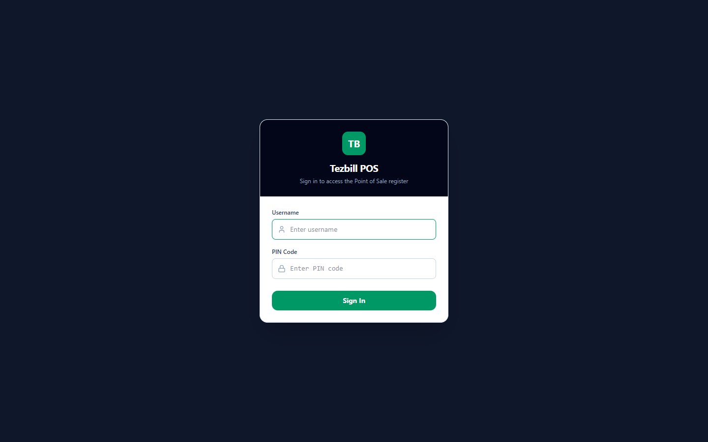
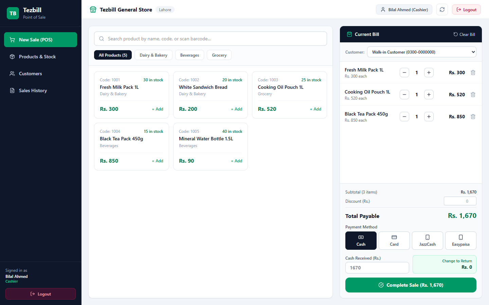
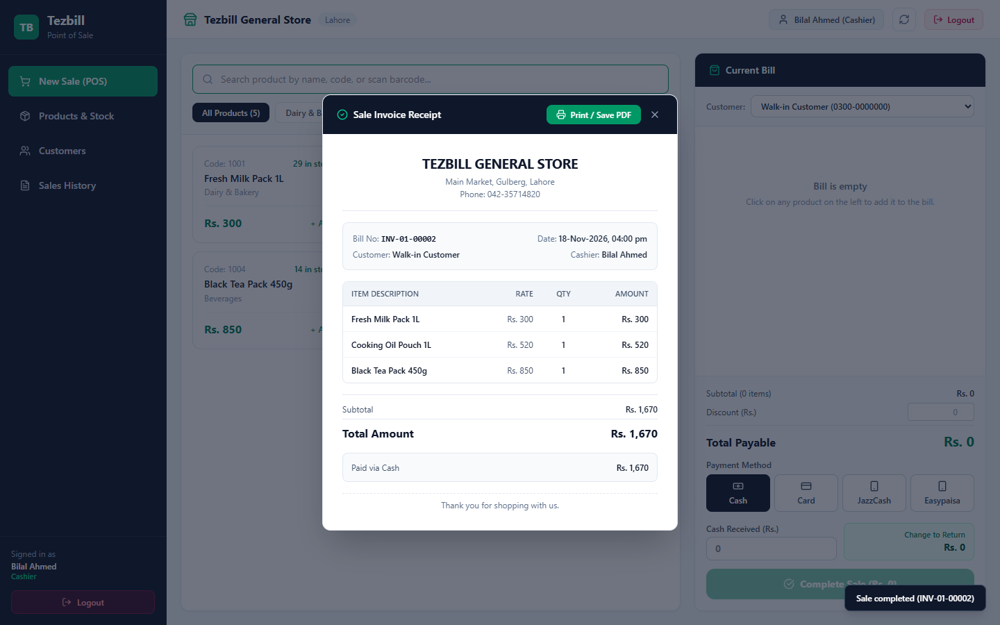
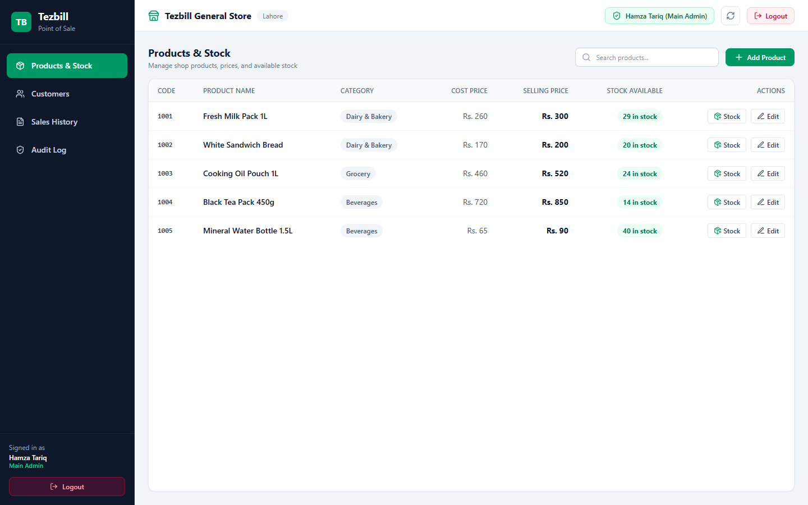
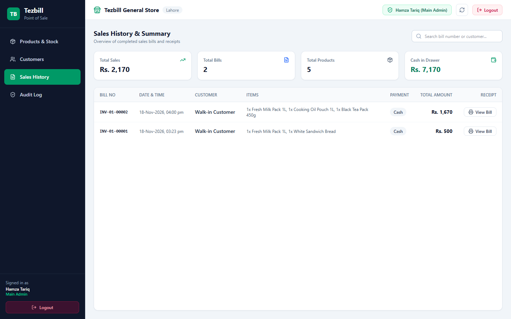
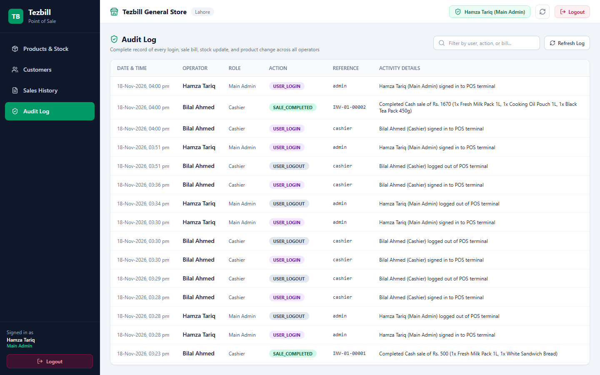

# Tezbill POS

Tezbill is a Point of Sale (POS) and retail store management system built with **Django**, **MySQL**, and **React** for retail shops in Pakistan. Its relational data model is derived from the Retail Pro Prism 2.0 database specification (`subsidiary`, `store`, `workstation`, `dcs`, `vendor`, `invn_sbs_item`, `invn_sbs_price`, `invn_sbs_item_qty`, `customer`, `document`, `document_item`, `tender`, `zout_control`, `drawer_event`, and `audit_log`).

---

## Application Walkthrough & Screenshots

### 1. Operator Sign-In
Operators authenticate using their assigned username and PIN code. The system enforces role-based access between **Cashier** counter billing and **Main Admin** store oversight.



---

### 2. Cashier — POS Counter Billing (`New Sale`)
Cashiers can search products by name, code, or barcode, filter by category (`Dairy & Bakery`, `Beverages`, `Grocery`), adjust item quantities, apply bill discounts, select a customer, and complete checkout via **Cash**, **Card**, **JazzCash**, or **Easypaisa** with automatic change calculation in `PKR` (`Rs.`).



---

### 3. Printable Sale Invoice Receipt
Completing a sale generates a sequential invoice (`INV-01-XXXXX`), deducts sold quantities from store stock (`invn_sbs_item_qty`), updates shift drawer totals (`zout_control`), and opens a print-ready invoice receipt formatted for physical printing or PDF export.



---

### 4. Admin — Products & Stock Management
Store administrators can add new products, edit cost and selling prices (`invn_sbs_price`), and update physical stock quantities (`adjustment` / `invn_sbs_item_qty`).



---

### 5. Sales History & Store Summary
Displays real-time store KPIs (**Total Sales**, **Total Bills**, **Total Products**, and **Cash in Drawer**) alongside a searchable ledger of completed sales bills with one-click receipt reprinting.



---

### 6. Main Admin — System Activity Audit Log
Accessible exclusively to the **Main Admin**, the Audit Log records every user sign-in, sign-out, completed sale, product change, stock adjustment, and customer registration with timestamps and operator attribution.



---

## Technology Stack

- **Backend**: Python 3, Django (`tezbill` project & `pos` app), Django REST Framework, `django-cors-headers`
- **Database**: MySQL 8.0+ (`django.db.backends.mysql` via `PyMySQL` / `mysqlclient`)
  - SQL DDL Schema: [`database/mysql_schema.sql`](database/mysql_schema.sql)
  - Django ORM Models: [`pos/models.py`](pos/models.py)
  - Schema Documentation: [`docs/schema-reference.md`](docs/schema-reference.md)
- **Frontend**: React 19, Vite 6, Tailwind CSS 4, Lucide Icons

---

## Getting Started

### 1. MySQL Database Setup

Create the MySQL database or import the standalone DDL schema:

```sql
CREATE DATABASE IF NOT EXISTS tezbill_db
  CHARACTER SET utf8mb4
  COLLATE utf8mb4_unicode_ci;
```

```bash
mysql -u root -p < database/mysql_schema.sql
```

Copy `.env.example` to `.env` and configure your MySQL connection credentials:

```env
DB_ENGINE=django.db.backends.mysql
DB_NAME=tezbill_db
DB_USER=root
DB_PASSWORD=your_mysql_password
DB_HOST=127.0.0.1
DB_PORT=3306
```

### 2. Install Dependencies

```bash
pip install -r requirements.txt
npm install
```

### 3. Run Migrations & Seed Data

```bash
python manage.py migrate
python manage.py seed_tezbill
```

### 4. Start the Application

```bash
npm run dev
```

- **POS Web Application**: `http://localhost:5173`
- **Django REST API**: `http://127.0.0.1:8000/api/health`
- **Django Admin**: `http://127.0.0.1:8000/admin`

### 5. Run Automated Tests

```bash
python manage.py test
```

---

## Default Accounts

| Full Name | Username | PIN Code | Role | Permissions |
| :--- | :--- | :--- | :--- | :--- |
| Hamza Tariq | `admin` | `1111` | `Main Admin` | Products & Stock, Customers, Sales History, Audit Log |
| Bilal Ahmed | `cashier` | `2222` | `Cashier` | New Sale (POS), Products & Stock, Customers, Sales History |
